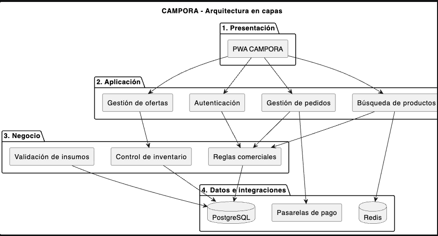
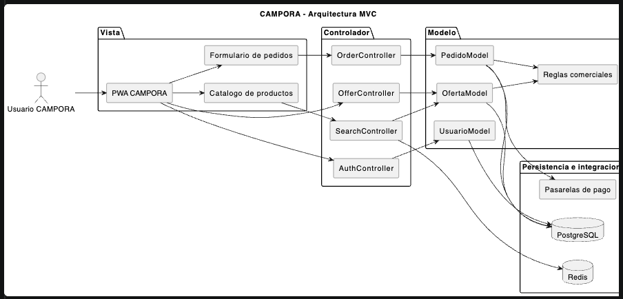
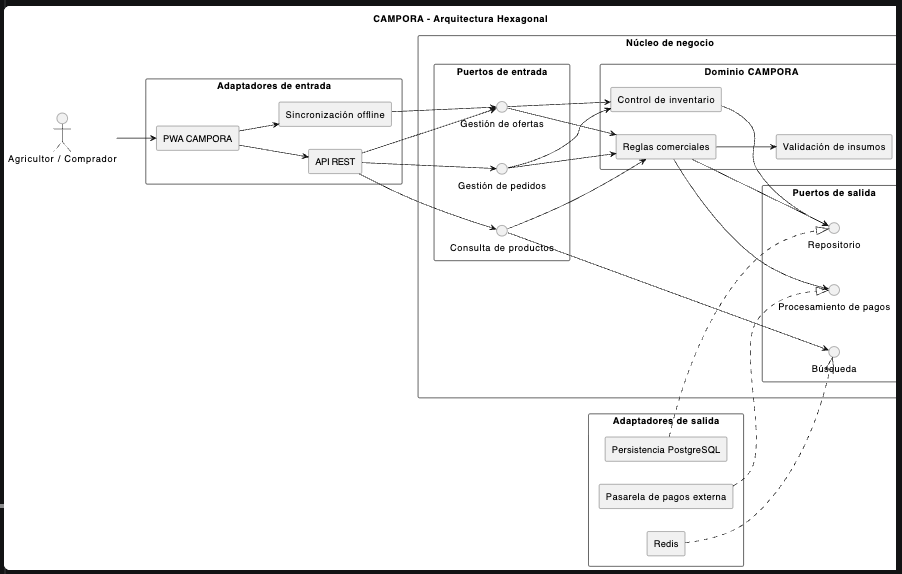
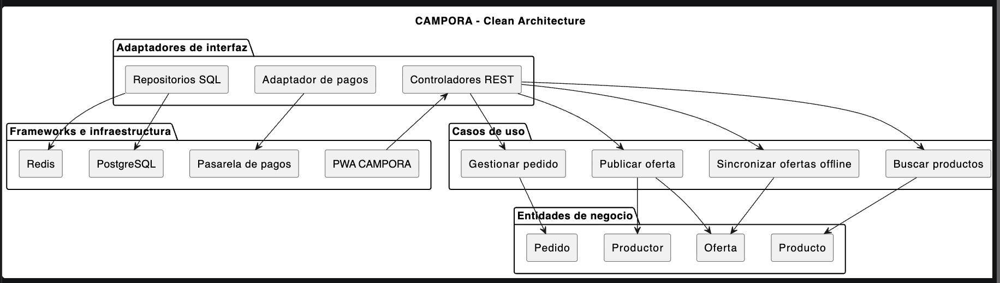
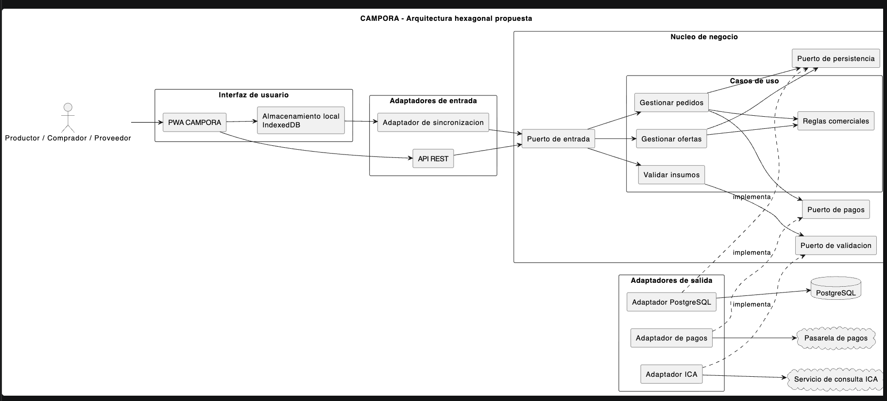

# UNIMINUTO
## Corporación Universitaria Minuto de Dios

### Ingeniería de Sistemas

# EVALUACIÓN Y SELECCIÓN DE ARQUITECTURA DE SOFTWARE

## Proyecto integrador: CAMPORA

**Presentado por:**

Lorena Barragán Barragán  
Diego Ñanguma  
Jonathan Díaz

**Presentado a:**

Juan Camilo Rodríguez Villada

**Asignatura:** Arquitectura de Software

**Fecha:** 21 de octubre de 2026

---

**Repositorio GitHub del proyecto:**

https://github.com/daiz2018/CAMPORA_VERSIONES

*Los archivos fuente de los diagramas, la matriz comparativa y la documentación arquitectónica se incorporarán a este repositorio como anexos editables de la entrega.*

---

## 1. Introducción

CAMPORA es una propuesta de plataforma digital orientada a conectar productores rurales, compradores urbanos y proveedores de insumos agropecuarios mediante un modelo de comercio bidireccional campo-ciudad.

El sistema busca facilitar la publicación de productos agrícolas, la búsqueda de ofertas, la gestión de pedidos y la adquisición de insumos, considerando las dificultades de conectividad que pueden presentarse en las zonas rurales.

El presente informe tiene como propósito evaluar cuatro alternativas de arquitectura de software: arquitectura en capas, Modelo-Vista-Controlador (MVC), arquitectura hexagonal y Clean Architecture.

Para realizar la evaluación se consideran los requisitos funcionales y no funcionales de CAMPORA, así como criterios de mantenibilidad, escalabilidad, facilidad de pruebas, acoplamiento, seguridad, interoperabilidad, simplicidad y flexibilidad tecnológica.

Finalmente, mediante una matriz comparativa ponderada, se propone la arquitectura más adecuada para el proyecto, justificando sus beneficios, riesgos y compromisos de implementación.

## 2. Caracterización del proyecto

### 2.1. Descripción general

CAMPORA es una plataforma digital de comercio bidireccional que busca facilitar las relaciones comerciales entre el campo y la ciudad.

Su funcionamiento contempla dos modalidades:

- **Campo → Ciudad:** los productores rurales publican y comercializan sus cosechas con compradores urbanos.
- **Ciudad → Campo:** los proveedores ofrecen insumos, herramientas y productos agropecuarios a los productores rurales.

### 2.2. Actores principales

- **Productor rural:** registra su finca, publica cosechas, consulta pedidos y adquiere insumos.
- **Comprador urbano:** busca productos agrícolas y realiza pedidos.
- **Proveedor:** publica y comercializa insumos agropecuarios.
- **Administrador:** supervisa usuarios, publicaciones y operaciones comerciales.

### 2.3. Funcionalidades principales

CAMPORA contempla la gestión de usuarios y perfiles, el registro de fincas, la publicación de ofertas agrícolas, la búsqueda de productos, el control de inventario y la gestión de pedidos.

También considera la integración con pasarelas de pago, la coordinación logística mediante terceros y la validación de insumos cuando corresponda.

### 2.4. Consideraciones técnicas

El proyecto contempla una aplicación web progresiva (PWA) con capacidad de almacenar temporalmente información en el dispositivo mediante IndexedDB.

Esto permitiría registrar determinadas operaciones sin conexión y sincronizarlas posteriormente.

Para la persistencia central se ha propuesto PostgreSQL y, como apoyo para caché, Redis. Las integraciones externas se realizarían mediante interfaces y adaptadores.

### 2.5. Alcance

CAMPORA actuaría como plataforma intermediaria para facilitar las operaciones comerciales. El procesamiento financiero dependería de proveedores de pago externos y el transporte físico sería realizado por operadores logísticos independientes.

## 3. Requisitos y restricciones

### 3.1. Requisitos funcionales

- **RF01. Gestión de usuarios:** permitir el registro, inicio de sesión y administración de perfiles de productores, compradores y proveedores.
- **RF02. Registro de fincas:** permitir que los productores registren sus fincas y soliciten su aprobación.
- **RF03. Publicación de ofertas:** permitir publicar productos agrícolas indicando precio, cantidad y disponibilidad.
- **RF04. Gestión de pedidos:** permitir crear pedidos y consultar su estado.
- **RF05. Comercialización de insumos:** permitir que los proveedores publiquen productos agropecuarios sujetos a validaciones cuando corresponda.
- **RF06. Sincronización offline:** permitir almacenar temporalmente ofertas sin conexión y sincronizarlas posteriormente.
- **RF07. Integración de pagos:** permitir gestionar solicitudes de pago y recibir confirmaciones de proveedores externos.

### 3.2. Requisitos no funcionales

- **RNF01. Mantenibilidad:** facilitar modificaciones en las reglas comerciales sin afectar innecesariamente otros componentes.
- **RNF02. Seguridad:** proteger la información de usuarios y operaciones mediante autenticación, autorización y comunicaciones cifradas.
- **RNF03. Disponibilidad:** conservar determinadas funciones de captura de información cuando no exista conexión.
- **RNF04. Escalabilidad:** permitir ampliar la capacidad del sistema conforme aumenten los usuarios y las transacciones.
- **RNF05. Interoperabilidad:** facilitar la integración con servicios externos mediante interfaces definidas.
- **RNF06. Testabilidad:** permitir realizar pruebas de la lógica comercial sin depender de servicios externos reales.

### 3.3. Restricciones y condiciones del proyecto

- CAMPORA debe considerar la conectividad limitada de algunos usuarios rurales.
- El desarrollo inicial debe ajustarse a los recursos de un equipo pequeño.
- El procesamiento de pagos dependerá de proveedores externos.
- La distribución física de productos dependerá de operadores logísticos.
- La arquitectura debe permitir incorporar nuevas integraciones sin rediseñar completamente el núcleo de negocio.

### 3.4. Implicaciones arquitectónicas

Los requisitos anteriores favorecen una arquitectura que permita separar la lógica comercial de las tecnologías externas.

En particular, la sincronización offline, las integraciones de pago y la validación de insumos requieren límites claros entre las reglas de negocio y los mecanismos de infraestructura.

## 4. Evaluación de las cuatro arquitecturas

### 4.1. Arquitectura en capas

*Figura 1. Arquitectura en capas de CAMPORA. Elaboración propia.*

### 4.2. Arquitectura MVC

*Figura 2. Arquitectura MVC de CAMPORA. Elaboración propia.*

### 4.3. Arquitectura hexagonal

*Figura 3. Arquitectura hexagonal de CAMPORA. Elaboración propia.*

### 4.4. Clean Architecture

*Figura 4. Clean Architecture de CAMPORA. Elaboración propia.*

### 4.5. Comparación general

Las cuatro alternativas permiten desarrollar CAMPORA, pero presentan compromisos diferentes.

Las arquitecturas en capas y MVC destacan por su simplicidad inicial. Hexagonal y Clean Architecture ofrecen una separación más estricta entre la lógica de negocio y las dependencias tecnológicas.

Para CAMPORA, esta separación resulta especialmente relevante por las integraciones externas y las necesidades de sincronización de información rural.

## 5. Matriz comparativa ponderada

### 5.1. Metodología de evaluación

Se evaluaron cuatro alternativas arquitectónicas mediante ocho criterios ponderados.

Cada arquitectura recibió una calificación de 1 a 5 por criterio, donde 1 representa un desempeño muy bajo y 5 un desempeño muy alto.

El resultado se calculó mediante la fórmula:

Puntuación ponderada = Σ (peso del criterio × calificación)

Los pesos suman el 100 %.

### 5.2. Resultados

| Criterio | Peso | Capas | MVC | Hexagonal | Clean |
|---|---:|---:|---:|---:|---:|
| Mantenibilidad | 20 % | 3 | 3 | 5 | 5 |
| Escalabilidad | 15 % | 3 | 3 | 4 | 4 |
| Facilidad de pruebas | 15 % | 3 | 3 | 5 | 5 |
| Bajo acoplamiento | 15 % | 3 | 2 | 5 | 5 |
| Seguridad e integridad | 10 % | 3 | 3 | 4 | 4 |
| Interoperabilidad | 10 % | 3 | 3 | 5 | 4 |
| Simplicidad | 10 % | 5 | 5 | 3 | 2 |
| Flexibilidad tecnológica | 5 % | 2 | 2 | 5 | 5 |
| **Total ponderado** | **100 %** | **3,15** | **3,00** | **4,55** | **4,35** |

### 5.3. Interpretación

La arquitectura hexagonal obtuvo la puntuación más alta, con 4,55 sobre 5, seguida de Clean Architecture con 4,35.

La arquitectura hexagonal destacó especialmente en mantenibilidad, facilidad de pruebas, bajo acoplamiento e interoperabilidad.

Por su parte, las arquitecturas en capas y MVC obtuvieron mejores valoraciones en simplicidad inicial.

Estos resultados corresponden a una evaluación académica razonada, no a mediciones experimentales de rendimiento.

### 5.4. Conclusión de la comparación

De acuerdo con la matriz ponderada, se recomienda adoptar la arquitectura hexagonal para el núcleo de negocio de CAMPORA.

Se propone implementarla inicialmente como un monolito modular para reducir la complejidad operativa del proyecto, manteniendo la posibilidad de separar módulos en servicios independientes cuando exista una necesidad comprobada.

## 6. Riesgos y compromisos

### 6.1. Matriz de riesgos

| Decisión arquitectónica | Beneficio esperado | Riesgo asociado | Atributo de calidad afectado | Estrategia de mitigación |
|---|---|---|---|---|
| Arquitectura en capas | Organización sencilla de responsabilidades | Acoplamiento entre capas | Mantenibilidad | Definir interfaces y evitar dependencias innecesarias |
| Aplicar MVC | Separación de interfaz y control de solicitudes | Controladores con demasiada lógica | Mantenibilidad y testabilidad | Trasladar reglas comerciales a servicios |
| Incorporar puertos y adaptadores | Independencia de tecnologías externas | Mayor complejidad inicial | Mantenibilidad y testabilidad | Crear abstracciones únicamente donde aporten valor |
| Aplicar Clean Architecture | Independencia del núcleo de negocio | Exceso de capas y abstracciones | Simplicidad y mantenibilidad | Evitar componentes innecesarios |
| Implementar sincronización offline | Operación con conectividad limitada | Duplicación o pérdida de información | Disponibilidad e integridad | Utilizar colas locales e idempotencia |
| Integrar pasarelas de pago | Facilitar transacciones comerciales | Fallos o notificaciones duplicadas | Seguridad e integridad | Validar webhooks y controlar reintentos |

### 6.2. Compromisos arquitectónicos

La arquitectura hexagonal ofrece ventajas en mantenibilidad, pruebas e interoperabilidad, pero exige mayor esfuerzo de diseño inicial.

Por esta razón, se propone implementar CAMPORA como un monolito modular con arquitectura hexagonal interna, evitando inicialmente la complejidad de desplegar numerosos microservicios.

Esta propuesta modifica la estrategia de despliegue planteada en el ADR-0001. El cambio deberá quedar documentado y aprobado por el equipo antes de considerarse definitivo.

### 6.3. Riesgos pendientes

La integración con fuentes oficiales para validar insumos agropecuarios todavía requiere verificación, según el ADR-0005.

Asimismo, las metas de rendimiento, presupuesto y escalabilidad documentadas anteriormente deberán validarse mediante pruebas y estimaciones técnicas.

## 7. Preguntas de reflexión

### 7.1. ¿Qué atributos de calidad se ven favorecidos por la arquitectura seleccionada?

La arquitectura hexagonal favorece principalmente la mantenibilidad, la facilidad de pruebas, la interoperabilidad y la flexibilidad tecnológica. En CAMPORA, permite separar las reglas comerciales de las bases de datos, pasarelas de pago y demás servicios externos.

### 7.2. ¿Qué compromisos técnicos deben asumirse?

El equipo deberá invertir más tiempo en diseñar puertos, adaptadores e interfaces. También necesitará establecer responsabilidades claras entre los módulos para evitar abstracciones innecesarias. Se propone comenzar con un monolito modular para reducir la complejidad operativa.

### 7.3. ¿Qué dificultades podrían presentarse si el sistema incrementa su cantidad de usuarios o funcionalidades?

Podrían presentarse problemas de rendimiento, mayor consumo de recursos y dificultades para mantener los módulos independientes. Para mitigarlos, será necesario realizar pruebas de carga, optimizar consultas y evaluar mecanismos de escalamiento. Si el crecimiento lo justifica, algunos módulos podrían extraerse como servicios independientes.

### 7.4. ¿Qué modificaciones serían necesarias si se reemplaza la tecnología de persistencia?

Sería necesario implementar un nuevo adaptador de persistencia que cumpla los contratos definidos por los puertos de salida. También habría que migrar los datos, revisar las transacciones y ejecutar pruebas de integración. Las reglas del dominio deberían requerir pocos cambios si se mantiene correctamente la separación de responsabilidades.

### 7.5. ¿Cómo influye la arquitectura seleccionada en la facilidad para desarrollar pruebas automatizadas?

La arquitectura hexagonal permite probar los casos de uso sin depender directamente de PostgreSQL, Redis o servicios externos. Mediante adaptadores simulados se pueden verificar las reglas de ofertas, pedidos e inventario. Esto facilita detectar errores y ejecutar pruebas automatizadas de forma independiente.

## 8. Arquitectura seleccionada

### 8.1. Arquitectura propuesta

Después de evaluar las cuatro alternativas mediante la matriz comparativa ponderada, se propone seleccionar la **arquitectura hexagonal**, con una puntuación de 4,55 sobre 5.

Esta arquitectura organiza el núcleo de negocio mediante puertos y adaptadores, separando las reglas comerciales de las tecnologías externas.

### 8.2. Justificación

La arquitectura hexagonal responde a las necesidades de CAMPORA por las siguientes razones:

- **Mantenibilidad:** facilita modificar los módulos de ofertas, pedidos y pagos sin afectar innecesariamente otras funcionalidades.
- **Interoperabilidad:** permite integrar pasarelas de pago, mecanismos de persistencia y servicios de validación mediante adaptadores.
- **Facilidad de pruebas:** permite verificar las reglas comerciales sin depender de bases de datos o proveedores externos reales.
- **Flexibilidad tecnológica:** facilita sustituir componentes de infraestructura conservando las interfaces del núcleo de negocio.

### 8.3. Estrategia de implementación

Se propone implementar inicialmente CAMPORA como un **monolito modular con arquitectura hexagonal interna**, organizado en módulos de usuarios, ofertas, pedidos, pagos e insumos.

La PWA conservaría su mecanismo de almacenamiento local y sincronización diferida.

PostgreSQL continuaría como sistema principal de persistencia y Redis podría utilizarse para caché cuando exista una necesidad justificada.

### 8.4. Relación con las decisiones anteriores

El ADR-0001 del equipo había seleccionado microservicios modulares orientados a eventos.

La presente evaluación propone reconsiderar esa decisión debido a la complejidad operativa de los microservicios para un equipo pequeño.

Esto no implica abandonar la separación de responsabilidades: los módulos conservarían límites definidos para permitir una futura extracción a servicios independientes si el crecimiento del proyecto lo requiere.

La nueva propuesta debe ser revisada por el equipo y validada con el docente antes de sustituir formalmente el ADR-0001.

### 8.5. Diagrama arquitectónico

*Figura 5. Arquitectura hexagonal propuesta para CAMPORA. Elaboración propia.*

## 9. Registro de decisión arquitectónica (ADR)

### ADR-006: Selección de arquitectura hexagonal para CAMPORA

**Estado:** Propuesto  
**Fecha:** 21 de octubre de 2026  
**Proyecto:** CAMPORA

#### Contexto

CAMPORA necesita gestionar ofertas agrícolas, pedidos, pagos, insumos agropecuarios y sincronización de información en condiciones de conectividad limitada.

El equipo había documentado previamente una arquitectura de microservicios orientados a eventos en el ADR-0001.

Para la presente evaluación se compararon cuatro alternativas: arquitectura en capas, MVC, hexagonal y Clean Architecture.

#### Decisión propuesta

Adoptar la arquitectura hexagonal para el núcleo de negocio de CAMPORA, implementada inicialmente como un monolito modular.

La propuesta se fundamenta en la matriz comparativa, donde la arquitectura hexagonal obtuvo una puntuación de 4,55 sobre 5.

#### Consecuencias positivas

- Separación entre reglas comerciales e infraestructura.
- Facilidad para realizar pruebas independientes.
- Mayor flexibilidad para integrar servicios externos.
- Menor dependencia de tecnologías específicas.

#### Consecuencias negativas

- Mayor complejidad inicial.
- Necesidad de diseñar puertos y adaptadores.
- Esfuerzo de aprendizaje para el equipo.

#### Condición de aprobación

Esta decisión permanecerá en estado **Propuesto** hasta que el equipo y el docente la validen.

En caso de aprobación, deberá actualizarse el ADR-0001 para evitar contradicciones entre decisiones arquitectónicas vigentes.

## 10. Conclusiones individuales

### 10.1. Conclusión de Diego Ñanguma (borrador)

La evaluación de las cuatro arquitecturas permitió comprender que seleccionar una arquitectura de software no depende únicamente de sus ventajas técnicas, sino también de las necesidades y recursos del proyecto.

En CAMPORA, la arquitectura hexagonal ofrece una alternativa adecuada para separar las reglas comerciales de las tecnologías externas, especialmente en los procesos de ofertas, pedidos y pagos.

Considero importante implementar esta arquitectura de manera gradual, evitando una complejidad innecesaria durante las primeras etapas de desarrollo.

### 10.2. Conclusión de Lorena Barragán (borrador para revisión)

La comparación arquitectónica evidencia la importancia de diseñar un sistema que pueda mantenerse y adaptarse a nuevas necesidades.

La arquitectura hexagonal permite organizar las responsabilidades de CAMPORA y facilitar las pruebas de sus funcionalidades principales.

Su implementación requiere planificación y una definición clara de los componentes para aprovechar sus beneficios.

### 10.3. Conclusión de Jonathan Díaz (borrador para revisión)

El análisis permitió identificar que cada arquitectura presenta ventajas y limitaciones según el contexto del proyecto.

Para CAMPORA, la separación entre la lógica de negocio y los servicios externos es relevante debido a las integraciones de pagos, persistencia y validación de insumos.

La arquitectura hexagonal representa una opción favorable, siempre que su complejidad se controle mediante una implementación modular y progresiva.

## 11. Referencias

## 11. Referencias

Barragán, L., Ñanguma, D., & Díaz, J. (2026). *CAMPORA: Documentación arquitectónica y diagramas C4* [Documento de proyecto no publicado].

Barragán, L., Ñanguma, D., & Díaz, J. (2026). *CAMPORA: Registros de decisiones arquitectónicas ADR-0001 a ADR-0005* [Documentación interna del proyecto].

Martin, R. C. (2017). *Clean architecture: A craftsman's guide to software structure and design*. Prentice Hall.

Richards, M., & Ford, N. (2020). *Fundamentals of software architecture: An engineering approach*. O'Reilly Media.

Cockburn, A. (2005). *Hexagonal architecture*. https://alistair.cockburn.us/hexagonal-architecture/

